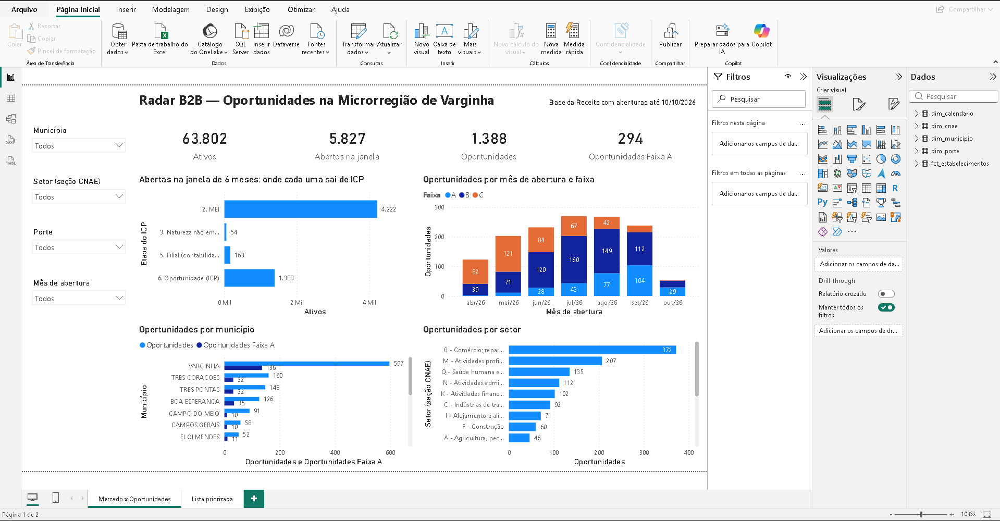
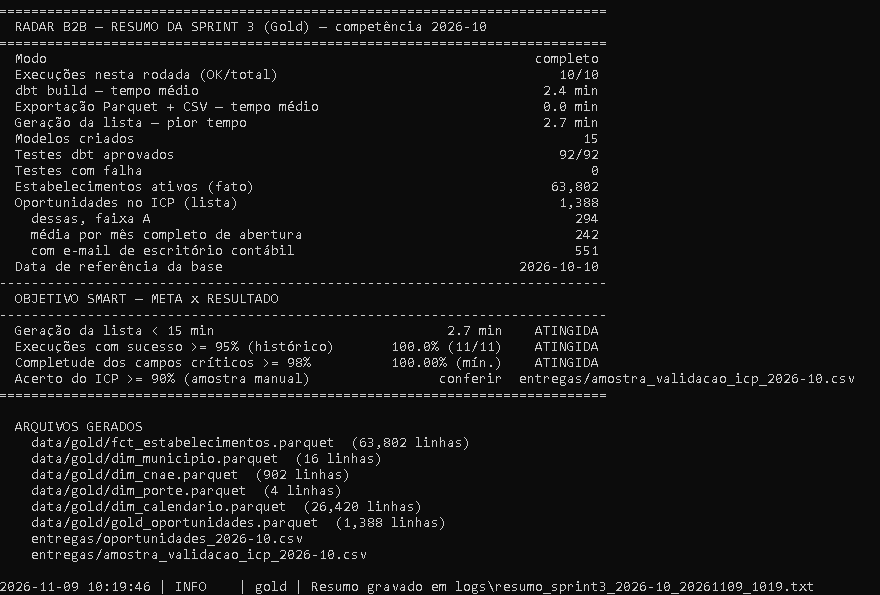
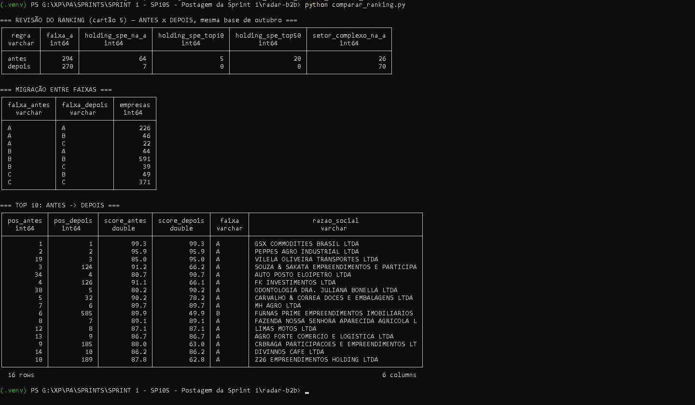
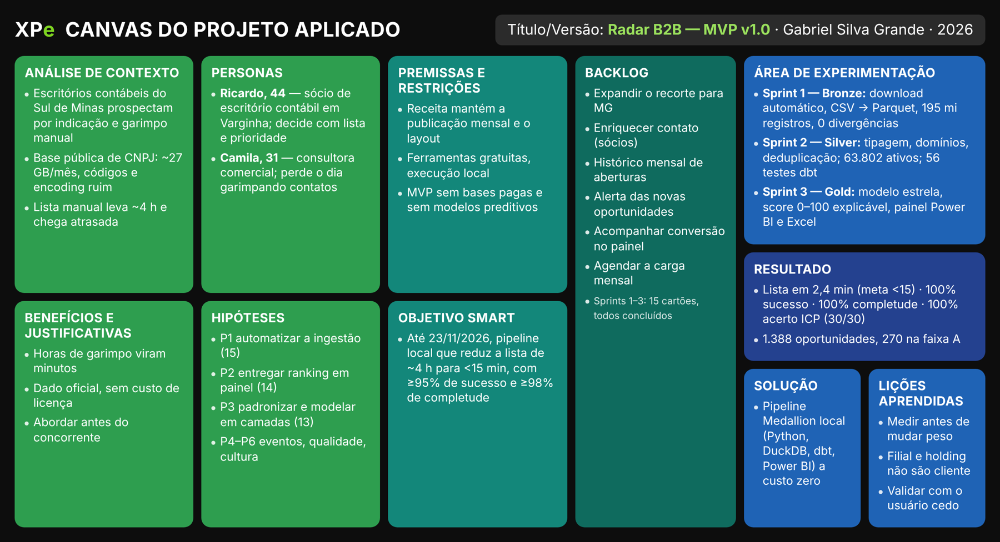

# Radar B2B — Projeto Aplicado (MVP)

> **Projeto acadêmico.** Este repositório é o **Projeto Aplicado** da pós-graduação em **Engenharia e Arquitetura de Dados com IA (XP Educação, 2026)**.
> Ele usa como base o meu projeto pessoal **[Radar B2B](https://github.com/GabrielKSG7/Radar-B2B)** e o recorta como um MVP local, no escopo e nos prazos do curso (três Sprints semanais).
> A evolução do produto continua no repositório principal.

Pipeline de dados local em arquitetura **Medallion** que transforma a base pública de CNPJ da Receita Federal em uma **lista mensal priorizada e explicável** de empresas recém-abertas na microrregião de Varginha (Sul de Minas), para a prospecção comercial de escritórios de contabilidade.

**Stack:** Python · DuckDB · Parquet · dbt-core (dbt-duckdb) · Power BI Desktop (projeto PBIP) — custo R$ 0, roda em um notebook.



## O problema

A informação de que um escritório contábil precisa para prospectar já é pública, mas está fora de alcance: dezenas de arquivos mensais, ~24 GB de CSV, campos codificados e encoding inconsistente. Montar uma lista de empresas novas na região leva horas de trabalho manual e o resultado não diz **quem abordar primeiro**.

## A solução

| Camada | O que faz | Sprint |
|---|---|---|
| **Bronze** | Download automatizado (WebDAV da Receita), CSV latin-1 → Parquet particionado, carga e validação no DuckDB (195 milhões de linhas, 0 divergências, −80% de armazenamento) | 1 |
| **Silver** | Tipagem, limpeza de encoding, domínios decodificados (seeds), deduplicação e recorte dos 16 municípios — 63.802 estabelecimentos ativos | 2 |
| **Gold** | Modelo estrela (fato + 4 dimensões), regra de ICP, **score de 0 a 100**, faixa A/B/C, ranking e o **motivo em texto** de cada posição | 3 |
| **Painel** | Power BI lendo os Parquet da Gold: mercado x oportunidades e lista priorizada com filtros | 3 |

Exemplo de motivo: *"aberta há 4 dias · fora do simples · porte demais · capital R$ 1,5 mi · sociedade · 3 CNAEs secundários · contato completo"*.

## Resultados (competência 2026-10)

| Meta do Objetivo SMART | Resultado |
|---|---|
| Lista gerada em < 15 min | 2,4 min em média (pior caso 10 min com cache frio) |
| ≥ 95% de execuções com sucesso | 100% (12 de 12) |
| ≥ 98% de completude nos campos críticos | 100% |
| ≥ 90% de acerto do ICP em amostra | 100% (30 de 30 CNPJs conferidos em consulta independente) |

- 1.388 oportunidades no perfil (~242 por mês), 270 na faixa A.
- 92 testes dbt (unicidade, integridade, completude, testes de negócio Gold x Silver e ranking x score).



## O que os dados ensinaram

- **Filiais no topo:** o porte e o capital vêm da matriz, mas a contabilidade de filial é decidida lá. Virou regra do ICP (1.551 → 1.388).
- **~40% das empresas novas já nascem com contador:** o e-mail do cadastro é do escritório que abriu a empresa. O ranking desconta esse sinal — e o dado mostra quais escritórios mais abrem empresas na região.
- **Capital alto não é cliente:** holdings, participações e SPEs dominavam o topo. A revisão do ranking derrubou essas estruturas na faixa A de 64 para 7 (top 10: de 5 para 0) e trouxe setores de rotina fiscal pesada de 26 para 70.
- **Medir antes de mudar peso:** duas hipóteses da revisão (falso "fora do Simples" e e-mails de contador escapando da regra) eram fracas no dado e foram tratadas com ajustes pequenos.



## Entrega final (dezembro/2026)

O Projeto Aplicado foi concluído com o relatório final e o pitch em vídeo para a banca.



- [Relatório final (PDF)](docs/entrega-final/relatorio_final.pdf): desafio, solução, as três Sprints e as considerações finais (resultados, contribuições e próximos passos).
- [Slides do pitch (PDF)](docs/entrega-final/pitch.pdf): a apresentação de cerca de 10 minutos.

**Limitação assumida:** a lista não foi validada por um escritório contábil real dentro do prazo das Sprints. A validação foi técnica (amostra de 30 CNPJs conferida em fonte independente, 100% de acerto). O piloto com escritórios é o primeiro próximo passo.

## Próximos passos

1. Piloto de quatro semanas com dois ou três escritórios, medindo quantas oportunidades da faixa A viram contato útil.
2. Agendar a carga mensal e guardar o histórico para detectar outros eventos (mudança de endereço, atividade e porte).
3. Completar o contato (sócios, e-mail e telefone) dentro da LGPD e entregar a lista do mês direto ao usuário, com texto de abordagem sugerido por IA.

## Como rodar (Windows)

```bat
python -m venv .venv
.venv\Scripts\activate
pip install -r requirements.txt

python run_sprint1.py --apagar-csv      :: Bronze: baixa e carrega a competência mais recente (~6 GB)
python run_sprint2.py                   :: Silver: tipagem, domínios, deduplicação, testes e docs
python run_sprint3.py                   :: Gold: ICP, ranking, exportação Parquet/CSV/XLSX e resumo SMART
python validar_amostra_icp.py           :: confere a amostra do ICP contra consulta independente
```

Painel: abra `painel\radar_b2b.pbip` no Power BI Desktop e clique em **Atualizar** (ajuste o parâmetro `PastaGold` se a pasta for outra, ou gere de novo com `python painel\gerar_pbip.py`).

Teste rápido sem internet: `python tests\gerar_amostra.py` e `python run_sprint1.py --pular-download --competencia 2000-01`.

## Estrutura

```
config/recorte_mvp.yml      fonte única das regras: recorte, ICP, pesos e ajustes do ranking
src/radar/                  download, extração, Bronze (Parquet) e carga/validação no DuckDB
radar_dbt/                  staging (stg_), Silver (slv_), Gold (dim_/fct_/gold_), seeds, macros e testes
run_sprint1..3.py           execução de cada camada com tempos e resumo
comparar_ranking.py         compara o ranking antes e depois de um ajuste de regra
validar_amostra_icp.py      conferência da amostra do ICP (meta SMART de 90%)
painel/                     projeto Power BI (TMDL + PBIR), gerador do projeto e medidas DAX
```

## Fora do escopo do MVP

Arquivo de Sócios, histórico mensal de eventos, orquestração e nuvem — tratados no [Radar B2B](https://github.com/GabrielKSG7/Radar-B2B).

---
Gabriel Silva Grande · [github.com/GabrielKSG7](https://github.com/GabrielKSG7)
